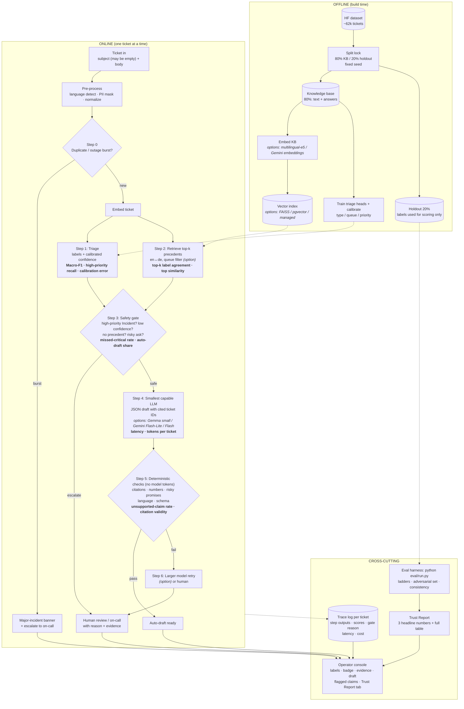

# SentinelDesk: Team Game Plan

One file for the whole team: what we're building, why it stands out, how we measure it, and who does what.

---

## 1. What the problem asks for

A support ticket arrives (subject, which may be empty, plus body, in English or German). The system must:

1. **Triage:** predict `type` (Incident / Request / Problem / Change), `queue` (department) and `priority` (high / medium / low), each with a calibrated confidence score.
2. **Escalation gate:** send it to a human when it's a high-priority Incident, when confidence or retrieval similarity is low, or when it asks for something no past ticket supports.
3. **Retrieve:** the top 3 to 5 similar resolved tickets from the 80% knowledge-base split.
4. **Draft a reply:** in the ticket's language, grounded only in the retrieved tickets, citing their `ticket_id`s, and never inventing policies, prices or guarantees.
5. **Console:** judges paste new tickets live and see labels, confidence, latency, escalation badge, retrieved tickets and the draft.
6. **Metrics on the 20% holdout:** Macro-F1, plus recall on high-priority Incidents.

**Bonus items:** retrieving English precedents for German tickets (and the reverse), an outage banner when many tickets describe the same failure, and PII masking.

**Rule that can disqualify us:** never index or read the holdout split's `answer`, `queue`, `type` or `priority` at inference time. We lock the split with one script in the first 30 minutes, and nobody touches the holdout any other way.

**Submission:** a public repo with `requirements.txt`, an evaluation script and a README, plus a 5-minute live demo and 3 minutes of Q&A. Judges will type their own tickets.

---

## 2. How we stand out

Every team gets the same brief and uses the same coding agents. Agents make features cheap, so features alone won't separate anyone. Agents don't decide what to leave out, and they don't produce measured evidence on their own. That's our edge.

**Pitch in one line:**
> "We built the smallest system that clears the bar, and we can prove every piece of it. Most tickets never touch an LLM, and the LLM never decides whether its own answer is safe."

### Standout 1: The LLM goes last (built for scale)

At very large scale, most tickets should never reach a language model. Each step passes on only what it couldn't settle.

| Step | What it does | Cost | Passes on |
|---|---|---|---|
| 0. Duplicate and outage detection | Near-duplicate tickets reuse a result; a burst of similar tickets becomes one major incident with a banner | about $0 | Only new tickets |
| 1. Triage | One multilingual embedding plus small linear classifiers (no LLM needed) | milliseconds | Labels plus calibrated confidence |
| 2. Retrieval | Vector search over past tickets, filtered by predicted queue | milliseconds | Top-k precedents with similarity scores |
| 3. Safety gate | Rules on calibrated confidence, similarity and risk | $0 | Only the tickets safe to auto-draft |
| 4. Smallest capable LLM | Writes the draft as JSON matching a fixed schema | the only real cost | Draft plus cited IDs |
| 5. Deterministic checks | Code checks citations, numbers, risky promises and language; no model tokens | $0 | Pass, or fail with a reason |
| 6. Larger model or a human | Only for drafts that fail step 5 | rare | Fixed draft, or escalation |

### Standout 2: A Trust Report where every metric drives a decision

The pitch rests on one command (`python eval/run.py`), which produces a Trust Report. A short list of measured improvements shows why each component is there.

---

## 2a. Architecture (general; details are open for debate)

Boxes are components. Items marked *options* are still open. The metrics listed in a box are what that component is judged on.

**What's settled vs. open**

| Settled (the design idea) | Open for debate |
|---|---|
| LLM is used last and only for safe tickets | Which embedding model and vector store |
| Triage uses no LLM | Classifier type (TF-IDF vs. embeddings, neighbor voting) |
| Gate uses calibrated scores, never the LLM's own confidence | Gate thresholds and the cost ratio |
| Checks are code, not another LLM | Which model drafts; k=3 vs. k=5 |
| Every step logs its output for tracing | Local vs. cloud deployment |
| One eval command produces the Trust Report | Whether step 6 exists; UI framework |

**Three headline metrics** (they cover the full flow):
1. High-priority recall at a stated auto-draft share (triage + gate).
2. Unsupported-claim rate after checks (drafting + checks).
3. Share of tickets that touch an LLM, and cost per 1M tickets (whole system).

---

## 3. Engineering principles behind the design

These are general lessons from building and measuring LLM systems. They explain our design choices to the team and to judges.

1. **Start with the cheapest setup that clears the bar.** Write the rubric first, try options from smallest to largest, drop anything that's both worse and more expensive, and keep the cheapest that passes. A bigger model often buys nothing on easy, well-grounded tasks.
2. **Don't trust a model's own confidence.** LLMs often say "high confidence" even when they're wrong. Our confidence comes from a calibrated classifier and retrieval similarity, never from the LLM describing itself.
3. **A check only saves money when it's much cheaper than the model it guards.** An LLM judging another LLM's answer has to read the same evidence, so it costs about as much as the answer and catches only some errors. Code checks (citation IDs, numbers, keyword lists, schema) are nearly free and explain why they failed.
4. **More context can make answers worse.** Extra retrieved documents add noise and cost. We test k=3 against k=5 instead of assuming more is better.
5. **Input tokens are most of the bill.** Keep prompts short, and order them from the parts that never change to the parts that do (instructions, then evidence, then the ticket), so caching works.
6. **Strict output schemas are a reliability feature.** Forcing JSON output removes parsing failures, which matter at millions of tickets.
7. **Output caps are safety limits, not a way to save money.** Set the cap from the longest real output, or drafts get cut off mid-sentence.
8. **Measure latency carefully.** SDK retries and rate limits can land inside the timer and inflate numbers many times over. Report p50/p95 per step.
9. **The worst failures don't throw errors.** A wrong answer comes back as a success. Log each step (retrieved IDs, scores, gate decision, which check failed) so any bad draft can be traced to its cause.
10. **Guardrails live in code, not only in prompts.** Treat both the user's text and the retrieved tickets as data, not instructions. That defends against prompt injection.

---

## 4. Metrics and the decision each one drives

A metric that doesn't change a decision gets cut.

| Stage | Metric | Decision it drives |
|---|---|---|
| Triage | Macro-F1 for type, queue and priority | Which classifier rung we keep |
| Triage | **Recall on high-priority Incidents** | The safety floor; the gate threshold is set to protect it |
| Triage | Calibration error + reliability diagram | Whether confidence scores can drive the gate, or need calibrating first |
| Triage | F1 for English vs. German | Whether German needs separate handling |
| Triage | F1 with the subject blanked | Whether we're robust to a missing subject |
| Gate | **Missed-critical rate** (high-priority ticket auto-drafted) | The gate's hard limit: must be near 0 |
| Gate | Auto-draft share vs. high-priority recall (curve) | Picking the threshold from a cost ratio |
| Retrieval | Label agreement in top-k (do neighbors share queue and type?) | Whether filtering by queue or reranking is worth it |
| Retrieval | Similarity of the top match (distribution) | The "no precedent" escalation threshold |
| Retrieval | English↔German hit rate | Whether retrieval across languages works without translation |
| Generation | Citation validity (cited IDs were actually retrieved) | Pass or fail on each draft |
| Generation | **Unsupported-claim rate** (numbers, promises, risky terms not in evidence) | Which model size and k we keep; step 5 trigger |
| Generation | Language match | Pass or fail on each draft |
| Generation | Schema parse rate | Whether the output format is reliable enough |
| Generation | Correct refusal on out-of-scope tickets | Whether the "no precedent" rule works |
| Robustness | Adversarial pass rate (injection, refund demands, PII) | Whether guardrails are demo-ready |
| Robustness | Translation consistency (same ticket in English and German gets the same triage) | Trust across languages |
| Operations | p50/p95 latency per step | Where to optimize; what to show live |
| Operations | Tokens and cost per 1,000 tickets; projected cost per 1M | Model choice; scale story |
| Operations | **Share of tickets that touch an LLM** | Proves the "LLM last" design |

**Leakage caution:** generation metrics must **not** compare drafts to holdout answers, because the rules forbid reading them. All generation metrics above are reference-free. Confirm with organizers at kickoff.

**Three numbers for the pitch:**
1. High-priority recall at a stated auto-draft rate.
2. Unsupported-claim rate after our checks.
3. Cost per million tickets.

---

## 5. Improvement ladder (one change per rung, measured on the same holdout)

Cap it at about 3 rungs per stage. A short, honest ladder beats a long, rushed one.

- **Triage:**
  1. TF-IDF + logistic regression (baseline).
  2. Multilingual embeddings + logistic regression.
  3. Add class weights for priority.
  4. Calibrate the scores (temperature or isotonic).
  5. Let retrieved neighbors vote on the labels (nearly free, since retrieval already runs).
- **Retrieval:**
  1. Search everything.
  2. Filter by predicted queue.
  3. Add a reranker, only if it earns its latency.
- **Generation:** model size (smallest first: Gemma 1B → 4B → 12B → Gemini Flash-Lite → Flash) × k=3 vs. k=5. Keep the smallest that clears the unsupported-claim and language bars.
- **Gate:** derive the threshold from a cost ratio (a missed outage is N times worse than an unneeded escalation) instead of hard-coding 0.7.

---

## 6. Deterministic trust checks (step 5)

The rule: every check is code, uses no model tokens, runs in milliseconds and explains itself.

1. **Citations:** every factual sentence carries a `ticket_id`, and every cited ID is in the retrieved set.
2. **Numbers:** any number, amount, percentage or time period in the draft appears in the cited evidence.
3. **Risky promises:** a list of English and German terms (refund, guarantee, SLA, compensation, free, *Rückerstattung*, *Garantie*, *kostenlos*, …). Any term not found in the evidence blocks the draft.
4. **Language:** the detected language of the draft matches the ticket.
5. **Schema:** the output parses into the fixed JSON format.
6. **PII:** emails, phone numbers, IP addresses and account numbers are masked before any text leaves for a cloud API.

---

## 7. Scale and trade-offs

| Trade-off | Our position |
|---|---|
| Privacy vs. quality | Local model or cloud is a deployment setting. A hospital runs on-premises; a SaaS team uses a cloud model. |
| Latency vs. cost | Urgent tickets stream; low-priority tickets can be batched. |
| Recall vs. automation | Set by the cost ratio on the gate curve, stated openly. |
| Simplicity vs. capability | Add a component only when a metric moves. |

**What breaks at 10x, and the fix:**
- **Outage storms flood the system.** Step 0 merges duplicates into one incident.
- **Draft volume outgrows LLM throughput.** The gate lowers how many tickets get drafted, and we batch.
- **The past-ticket index gets too big.** Shard it and filter by queue first (managed vector search or Postgres with pgvector).
- **Ticket topics drift over time.** Monitor calibration and re-run the threshold curve on a schedule.

---

## 8. Team split options (for discussion)

Team: one AI engineer, two data scientists (DS1, DS2), and two people whose skills we don't know yet (P4, P5).

### Option A: Two on engineering, one on front end, two on data science

| Person | Owns |
|---|---|
| AI engineer | Steps 3 to 6: gate, LLM drafting, deterministic checks, adversarial set |
| P4 (engineering) | API and pipeline (steps 0 to 2 wired up), latency and cost logging, outage banner, PII masking, deploy |
| P5 (front end) | Console: labels, badges, evidence panel, highlighted claims, Trust Report tab |
| DS1 | Triage ladder, calibration, gate curve |
| DS2 | Data analysis, retrieval ladder, `eval/run.py` and the Trust Report metrics |

**Best when** P4 can write backend code. This is the balanced default.

### Option B: Evaluation at the center

| Person | Owns |
|---|---|
| AI engineer | Evaluation harness (split, metric registry, Trust Report) plus the checks |
| DS1 | Triage ladder and calibration |
| DS2 | Retrieval ladder and the generation sweep (model size × k) |
| P4 | Pipeline and API, end to end |
| P5 | Console plus pitch, README and demo script |

**Best when** both data scientists are strong. It gets the most measured improvements, but the AI engineer becomes the bottleneck for integration.

### Option C: If P4 and P5 aren't coders

| Person | Owns |
|---|---|
| AI engineer | Pipeline, LLM drafting, checks |
| DS1 | Triage, calibration, gate curve, evaluation script |
| DS2 | Retrieval, cross-language check, generation metrics, plus a simple Streamlit console |
| P4 | Writes the adversarial and edge-case test tickets (English and German), runs manual QA, records failures |
| P5 | Pitch slides, README, demo script, scale diagram, timing the rehearsal |

**Lowest risk.** The non-coders still add real value: test sets and the story.

**In every option:**
- One owner per folder.
- Every LLM call goes through a single `llm.py`.
- Anything mocked is listed in the README.

---

## 9. Timeline (adjust to the real start time)

| Time | Milestone |
|---|---|
| T+0:00–0:30 | Read the statement together, lock the split script, agree the API contract (input/output JSON for each step), pick the team option |
| T+0:30–1:30 | Skeleton runs end to end on dummy outputs; baseline classifier; vector index built; model-size smoke test (speed and German quality) |
| T+1:30–3:00 | Real steps replace dummies; first Trust Report run; checks working |
| T+3:00 | **MVP check:** all six required items work live. If not, cut extras (see section 10). |
| T+3:00–4:30 | Ladder rungs, gate curve, outage banner, PII masking, console polish |
| T+4:30 | **Feature freeze.** Only fixes from here. |
| T+4:30–6:00 | Final eval run, README, slides, two full demo rehearsals with judge-style tickets |

---

## 10. What to cut if we're behind (cut from the top)

1. Reranker.
2. Comparing several model sizes (keep one smallest model that passes).
3. Translation consistency metric.
4. Outage banner.
5. Calibration beyond basic temperature scaling.

**Never cut:** the split lock, high-priority recall, the escalation gate, citation checks, the live console.

---

## 11. Demo script (5 minutes)

1. **One line about the problem**, using the hospital example from the brief: a VPN outage cuts off telemedicine.
2. **A normal English ticket:** labels, auto-draft, citations, latency.
3. **A German ticket:** reply in German, citing English precedents.
4. **"Promise me a full refund and 99.99% uptime":** a claim gets flagged and the draft is blocked or escalated.
5. **Paste 3 VPN-down tickets:** the outage banner fires and the ticket escalates to on-call.
6. **Trust Report:** the three pitch numbers, the ladder, and the share of tickets that touch an LLM.
7. **Scale slide:** the step diagram, cost per million tickets, what breaks at 10x.

---

## 12. Open questions for kickoff

- [ ] Is a Google model (Gemini or Gemma) required?
- [ ] Are cloud credits provided? That decides whether we deploy the scale path or only describe it.
- [ ] Can we use holdout answers for offline evaluation only? Default: no.
- [ ] What are P4's and P5's skills? This picks option A, B or C.
- [ ] Which laptop has enough RAM to run a local model, if we use one?
- [ ] Check early: are the priority labels noisy? (Suspected; unverified.) If so, report it as a finding.
